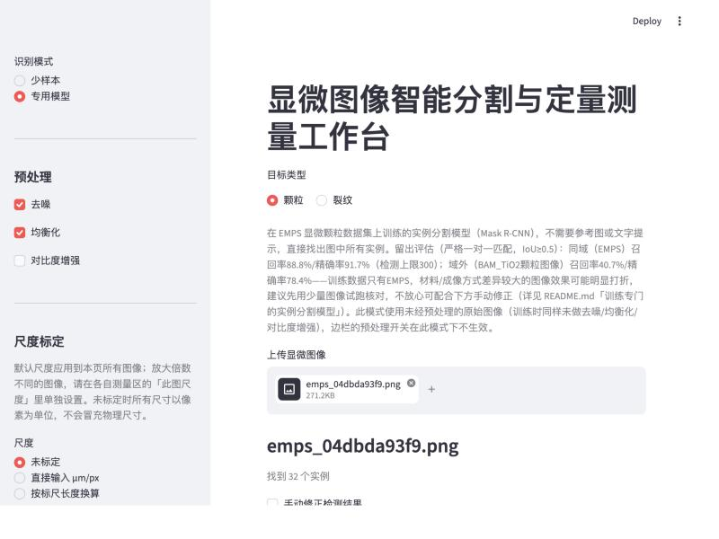

# Microscopy image segmentation and quantitative analysis workbench

A Streamlit application for microscopy image segmentation, manual mask correction, scale calibration, morphology measurement, visualization, and report export. It was independently developed as a competition project and later used to investigate why generic SAM feature matching struggles on dense, small microscopy targets.



## Current capabilities

- **Few-shot segmentation:** select target structures in 1–3 reference images, match frozen SAM features, and decode masks with a shared SAM predictor.
- **Task-specific instance segmentation:** Mask R-CNN models for particles and dense microcracks.
- **Manual correction:** add regions with SAM box prompts, erase pixels, delete instances, and merge instances.
- **Quantitative measurement:** particle area, perimeter, equivalent diameter, circularity, and aspect ratio; crack area, skeleton length, mean width, and aspect ratio.
- **Scale calibration:** direct µm/px entry, scale-bar measurement, or field-width conversion; uncalibrated outputs stay explicitly in pixels.
- **Export:** overlay images, CSV measurements, histograms, and Word reports.
- **Large-image handling:** tiled detection with overlap and memory guards.

The competition branch intentionally removed the earlier Grounding-DINO zero-shot mode after experiments showed that it was unreliable for dense microscopy textures.

## Evaluation snapshot

- Particle Mask R-CNN on the EMPS test split: **85.8% recall, 91.6% precision**, mean matched IoU 0.913.
- The same particle model on the out-of-domain BAM_TiO2 test split: **40.7% recall, 78.4% precision** after increasing the per-image detection limit.
- DenseCrack held-out merge-radius evaluation: approximately **72.2% recall and 71.4% precision**.
- The few-shot exhaustive mode remains experimental: matched masks can be accurate, but recall is limited and performance depends strongly on reference selection and image domain.

These metrics are not directly interchangeable: EMPS has instance-ID labels, DenseCrack instances are approximated from connected components, and BAM_TiO2 uses binary masks whose connected components may merge touching particles. See [development notes](docs/DEVELOPMENT_NOTES_zh.md) for the complete experiments and caveats.

## Repository layout

```text
app.py                    Streamlit entry point
config.py                 paths, checkpoint names, and device preference
core/detectors/           few-shot and task-specific detectors
core/segmentation/        SAM wrapper and prompt decoding
core/measurement.py       particle and crack measurements
core/mask_editor.py       correction and instance operations
core/report.py            Word report generation
scripts/                  training, evaluation, and dataset preparation
tests/                    unit and Streamlit smoke tests
data/demo_images/         redistributable demonstration images
models/                   local checkpoints (large .pth files are ignored)
```

## Setup

Python 3.11 is recommended. The checked-in dependency versions reflect the last tested Apple Silicon environment; other platforms may need a compatible PyTorch/torchvision pair.

```bash
python3 -m venv .venv
source .venv/bin/activate
pip install -r requirements.txt
```

Download the official SAM ViT-B checkpoint from Meta's [Segment Anything repository](https://github.com/facebookresearch/segment-anything) and place it at:

```text
models/sam_vit_b_01ec64.pth
```

The custom particle and crack checkpoints are not included in this GitHub package. Place them at `models/instance_segmenter.pth` and `models/crack_segmenter.pth` if available. The app can still expose the few-shot workflow with only SAM; task-specific modes report unavailable checkpoints instead of downloading them silently. See [models/README.md](models/README.md).

## Run

```bash
streamlit run app.py
```

Then open `http://localhost:8501`. Example images and their attribution are documented in [data/demo_images/README.md](data/demo_images/README.md).

## Test

Most unit tests do not run model inference. The Streamlit smoke tests import the application and therefore require the SAM checkpoint at the configured path:

```bash
python -m unittest discover -s tests -v
```

## Data and model policy

- Full datasets, trained `.pth` checkpoints, generated reports, virtual environments, build packages, and caches are excluded from Git.
- `data/datasets/SOURCES.md` records dataset provenance, annotations, intended use, and license constraints.
- Demo images from EMPS and DenseCrack retain their original dataset licenses and attribution requirements; they are not relicensed as project code.
- Do not commit API keys or `.streamlit/secrets.toml`.

## Known limitations

- Few-shot feature matching can confuse background texture with small particles and is not a general-purpose “find every instance” solution.
- Particle performance drops substantially across domains.
- The crack model was trained on DenseCrack and performs poorly on macro-scale crack photographs or substantially different materials.
- Dense objects, scale-bar reading, mask correction, and tiled inference all introduce uncertainty; the exported measurements should be reviewed before scientific use.
- This is a research/competition prototype, not validated clinical or industrial metrology software.

## Documentation

- [Chinese running guide](docs/RUNNING_GUIDE_zh.md)
- [Full Chinese development and experiment notes](docs/DEVELOPMENT_NOTES_zh.md)
- [Dataset sources and licenses](data/datasets/SOURCES.md)

## License

No software license has been selected yet. Add a `LICENSE` file before inviting reuse or contributions. Third-party datasets, demo images, pretrained models, and model checkpoints remain subject to their own licenses.
